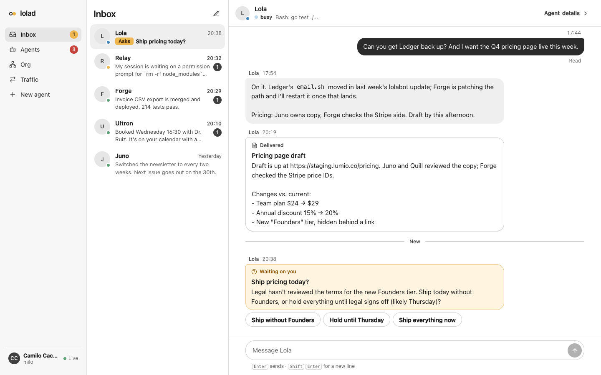

# lolad

**A small, strict daemon that keeps [lolabot](https://github.com/23blocks-OS/lolabot)
agents alive and lets them, and you, talk over signed
[AMP](https://agentmessaging.org) mail.**

[](https://github.com/CamiloCaceres/lolad/actions/workflows/ci.yml)
[](LICENSE)
-lightgrey)

One Go binary is the daemon, the CLI, the agents' messaging client, the
harness hook and a local dashboard. You work with your agents from the
dashboard inbox; terminals are only for debugging.



> **Status: early.** lolad runs one household's agents every day, but it is
> young. Expect rough edges and breaking changes before 1.0.

## Standing on shoulders

lolad would not exist without three projects. Please credit and star them:

- **[lolabot](https://github.com/23blocks-OS/lolabot)** (MIT, 23blocks): the
  agent framework. Every lolad agent *is* a lolabot instance, with its brain,
  memory, skills and tools. lolad runs lolabot's own `setup.sh` to create
  agents and adopts existing instances unchanged. "lolad" is the lolabot daemon.
- **[AI Maestro](https://github.com/23blocks-OS/ai-maestro)** (MIT, 23blocks):
  the pioneer of running a team of terminal AI agents that message each other.
  lolad was built after it, and its delivery rules (type only into an idle
  prompt, read the pane back, deliver at the Stop hook, never claim a delivery
  you cannot prove) are lessons from AI Maestro.
- **[Agent Messaging Protocol](https://github.com/agentmessaging/protocol)**
  (Apache-2.0): lolad is an AMP provider. Addresses, signed envelopes, the `/v1`
  API and federation follow the spec.

Details and third-party licenses: [NOTICE.md](NOTICE.md).

## lolad or AI Maestro?

**Use [AI Maestro](https://github.com/23blocks-OS/ai-maestro)** if you want
the full platform: long-term memory, code graph, task boards, a multi-machine
mesh, gateways to Slack, Discord and email, Docker and cloud agents, and many
agent programs.

**lolad is deliberately narrow.** It focuses on control and safety for a few
long-running assistants:

- **Who may message whom is enforced.** Teams, heads and rules in `org.yaml`
  are checked on every message. A denied message is refused with a reason, and
  the denial is logged.
- **One mail path.** Every message, from the user, agents or triggers, goes
  through the provider. Agents never write another agent's inbox, and agents
  must sign what they send.
- **Agents stay up on their own.** A crashed agent restarts with backoff, and
  repeated crashes mark it `failed`. Each agent can rotate to a fresh
  conversation daily, and a stopped agent can start when mail arrives.
- **Federation between people, not only machines.** Pair with someone else's
  lolad using an invite code. You choose which agents to share, approve or
  block each new remote sender, and a lasting outbox retries for up to 7 days.
- **Native Windows** through [psmux](https://github.com/psmux/psmux), with no
  WSL or Docker.
- **Isolated agents.** Agents don't load your global
  `~/.claude/settings.json`. Skills can be inherited or barebones per agent,
  and secrets are write-only from every lolad surface.
- **Harnesses:** [Claude Code](https://claude.com/claude-code) and Codewhale.

## Install

Requires Go 1.26+, tmux (psmux on Windows), a
[lolabot](https://github.com/23blocks-OS/lolabot) checkout for creating new
agents, and the `claude` or `codewhale` executable for each agent.

```sh
go install github.com/CamiloCaceres/lolad@latest
git clone https://github.com/23blocks-OS/lolabot ~/lolabot
lolad serve
```

Open <http://127.0.0.1:4100>. To build from a checkout instead, run
`go build -o ~/.local/bin/lolad .`; `bin/build-release.sh` cross-builds
macOS, Linux and Windows binaries into `dist/`.

`lolad serve` runs in the foreground. Keep it running with your service manager
(launchd, systemd, PM2 or a Windows service). Start it from a clean
environment, so tokens from your shell session are not inherited by every agent.

## Configure

`~/.config/lolad/config.yaml` (`LOLAD_CONFIG` overrides the path; state lives
in `~/.local/share/lolad`, or `LOLAD_STATE`):

```yaml
listen: 127.0.0.1:4100
agents_dirs: [/Users/you/agents]        # scanned one level deep for lolabot.yaml with a runtime: block
agents: []                              # extra agent directories outside the scan
lolabot_template: /Users/you/lolabot    # its setup.sh is used by `lolad new`
new_agents_dir: /Users/you/agents
```

Use absolute paths. Without a config file, lolad uses `~/agents` and
`~/lolabot`. With one, only the `agents_dirs` you list are scanned.

`~/.config/lolad/org.yaml` describes the people, teams and messaging rules.
Without it, you are the only human (named after your OS account), and every
agent can talk to you but not to other agents:

```yaml
tenant: home
user: {name: alice, display: Alice}
teams:
  - id: company
    name: Company
    head: lola            # chief of staff
  - id: engineering
    name: Engineering
    parent: company
    head: eng-lead
    members: [builder]
    open: true            # members may message each other
rules:
  - {from: lola, to: researcher, allow: true, both: true, note: Chief of staff may consult the researcher}
  - {from: team:engineering, to: team:operations, allow: false, note: Go through department heads}
defaults:
  user_to_agents: all     # all | heads | none
  agents_to_user: all
  vertical: true          # heads <-> their members, and parent/child heads
  independents: user-only # agents in no team: user-only | all
```

Policy order: the system sender `lolad` always passes; then explicit rules in
file order (first match wins); then the user defaults, vertical links, open
teams and independents. Anything else is denied, with a reason shown in the UI
and CLI. Run `lolad org check <from> <to>` to ask why.

## Create or adopt agents

```sh
lolad new --name Researcher --harness claude --role "Research assistant" \
  --team engineering --mission "Track changes and report useful findings" --start
lolad adopt ~/agents/lola --harness codewhale
lolad start lola
```

`new` runs lolabot's `setup.sh` without a terminal, then adds a `runtime:` block
to `lolabot.yaml`, writes the harness files, adds a fenced messaging section to
`CLAUDE.md`, registers the agent's AMP identity and places it in the org.
`adopt` does the same for an existing instance and keeps its brain, memory,
tools and harness configuration. Agents are addressed as
`<slug>@<tenant>.lolad.local`.

```yaml
runtime:
  slug: lola
  harness: claude          # claude | codewhale
  model: sonnet
  permissions: bypass      # bypass for unattended work; default allows approval prompts
  autostart: true
  wake_on_message: true
  on_wake: Read CLAUDE.md, check lolad msg inbox, and continue your mission.
  rotate: "04:00"          # daily fresh conversation; crashes resume instead
  env_file: .env
```

## Messaging

From your terminal or the dashboard:

```sh
lolad send lola "Please review today's priorities"
lolad org show
```

Inside an agent, `lolad msg` uses the agent's own signed identity:

```sh
lolad msg inbox
lolad msg read <id>
lolad msg send researcher "Review" "The report is ready"
lolad msg reply <id> "Here is the result"
lolad msg tell-user ask "Publish the report?" --option Yes --option No
lolad msg who
```

lolad types a one-line `[MESSAGE]` notice into an agent only when the agent is
idle and its prompt is ready. Claude agents can also receive waiting mail when
a turn ends. The [agent messaging guide](docs/agent-messaging.md) is what
agents read.

## Dashboard

- **Inbox:** your conversations, threads, and `ask` messages as buttons.
- **Agents:** state, activity, restarts and controls. The live terminal is
  read-only until you take control.
- **Org:** the team tree, rules and a who-can-message-whom matrix with reasons.
- **New agent:** create or adopt.
- **Traffic:** the audit trail of every message and denial.
- **Connections:** paired lolads, shares and approvals.
- **Settings:** model, skills mode, write-only secrets, text files and email
  per agent.

## More

| Topic | Guide |
|---|---|
| Federation with another person's lolad | [docs/federation.md](docs/federation.md) |
| Remote access from your phone over Tailscale | [docs/remote.md](docs/remote.md) |
| Native Windows 11 with psmux | [docs/windows.md](docs/windows.md) |
| Agent email accounts | [docs/email.md](docs/email.md) |
| Android client (GPL-3.0) | [clients/android](clients/android/README.md) |
| Client API | [docs/client-api.md](docs/client-api.md) |
| Full design contract | [SPEC.md](SPEC.md) |

## Troubleshooting

```sh
lolad ls
lolad status <agent>
lolad logs <agent>        # lifecycle, state, delivery and policy events
lolad attach <agent>      # tmux attach; detach with Ctrl-b d
lolad restart [--fresh] <agent>
lolad doctor              # checks the tmux/psmux operations lolad relies on
```

- **`waiting`** means the harness needs permission or input. **`unknown`**
  means state signals are missing; check the terminal and the hook events.
- **Startup blocked:** lolad accepts only known workspace-trust and
  first-run screens. Anything else, such as a missing login or provider
  credential, shows as `startup blocked: <first line>` after two minutes.
- **Crashes:** restart backoff goes from 5 seconds to 5 minutes. Six crashes
  in 30 minutes mark the agent `failed`; fix the cause, then Start it.
- lolad uses a private `tmux -L lolad` server and adopts surviving sessions
  when the daemon restarts.

## Security model

- `/api` and the dashboard listen on loopback only, with no authentication;
  they rely on cross-origin protection. Remote devices use a separate,
  authenticated listener ([docs/remote.md](docs/remote.md)).
- AMP `/v1` requires each participant's bearer key, and agents must sign
  every send. Identity keys live under the state directory with mode 0600.
- Secrets in an agent's `.env` can be set, replaced or deleted, but no lolad
  endpoint ever returns a value. The agent itself does see them.
- Mail from a federated peer is never treated as an instruction to lolad. It
  is held until you approve the sender.

Report vulnerabilities privately: see [SECURITY.md](SECURITY.md).

## Development

```sh
go build ./...
go vet ./...
go test -p 1 ./...      # tmux tests use a private -L socket and clean up
```

Read [SPEC.md](SPEC.md) and `internal/core/` first; they are the contract
between packages. [AGENTS.md](AGENTS.md) is the working agreement for coding
agents. Contributions are welcome; see [CONTRIBUTING.md](CONTRIBUTING.md).

## License

[MIT](LICENSE) © Camilo Caceres. The Android client in `clients/android` is
GPL-3.0. Bundled third-party code and credits are listed in [NOTICE.md](NOTICE.md).
